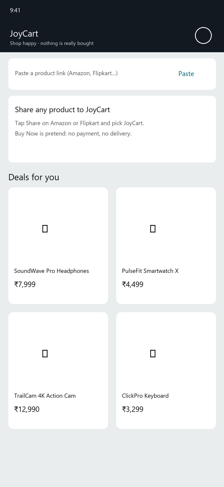
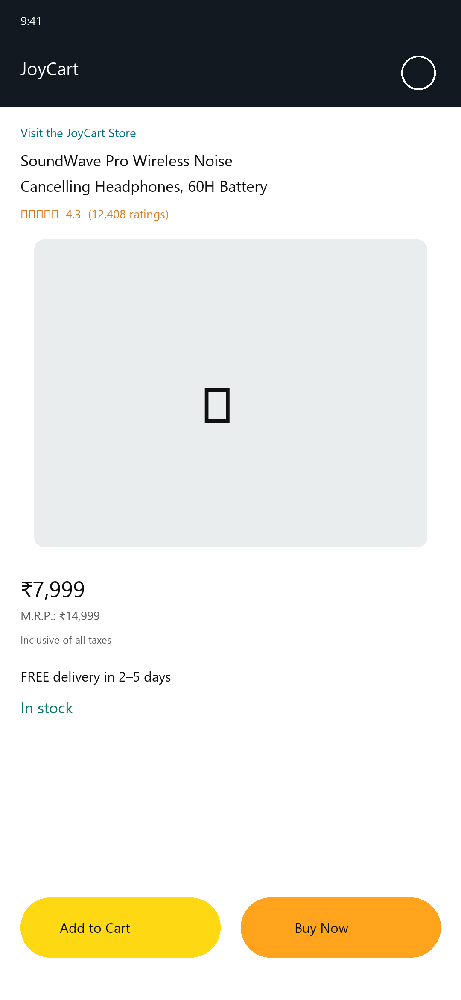
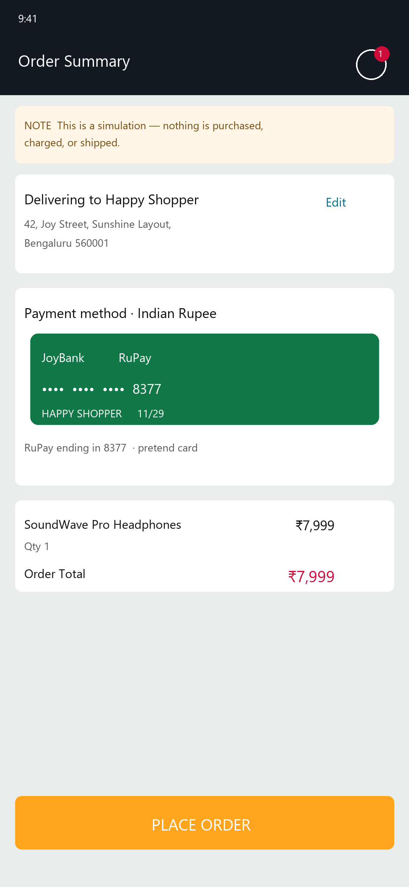
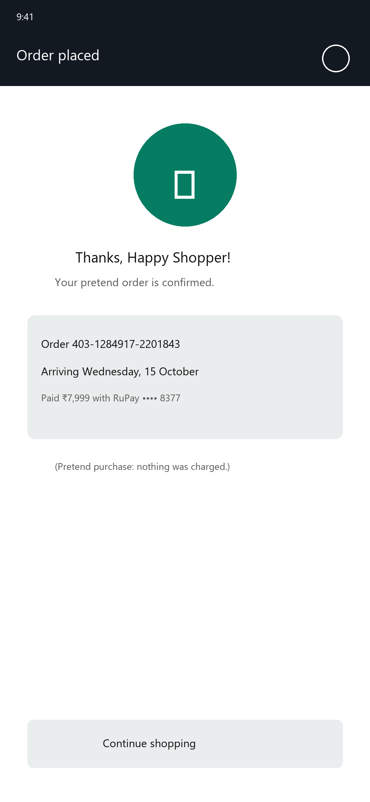
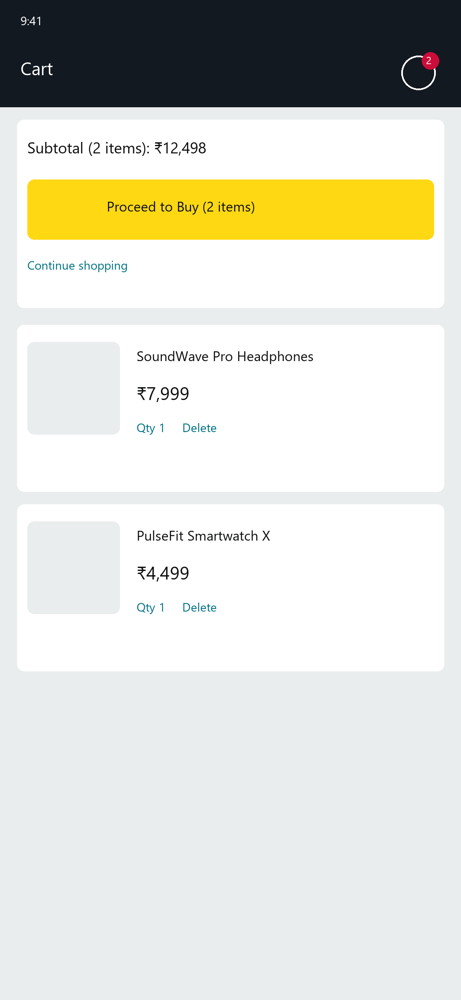

# JoyCart — pretend shopping for Android

> [!WARNING]
> **For educational purposes and individual use only.** JoyCart is a personal learning project. Nothing is purchased, charged, or shipped. Read the [Disclaimer](DISCLAIMER.md) before installing.

**[Product page](https://navforu.github.io/joycart-app/)** · **[Latest APK](../../releases/latest)**

Share an Amazon or Flipkart product into JoyCart, tap Buy Now or Add to Cart, and enjoy a fake checkout. Pretend cards and the delivery address stay on the device; the cart and orders vanish when the app closes.

This repository only publishes the showcase site, screenshots, and APKs. The source code is maintained privately; every release here is built and uploaded automatically by CI.

## Screens

| Home | Product | Checkout |
| :---: | :---: | :---: |
|  |  |  |
| **Order placed** | **Cart** | |
|  |  | |

## Use cases

**Share a product from Amazon or Flipkart.** On a product page, tap Share and pick JoyCart. The listing opens in-app; Buy Now and Add to Cart are pretend.

**Paste a link on Home.** Drop an `https` URL into the field and tap Open. JoyCart scrapes title, image, and price when the page exposes them.

**Fix a wrong price or currency.** Tap the bottom bar to edit the name, amount, and currency (₹, $, £, and others). Homepage banners are ignored so a storefront front page does not become a fake $79.99 product.

**Keep pretend cards on the phone.** Saved cards match the checkout currency. Nothing is sent to a payment network.

## Download

Get the latest `JoyCart-<version>.apk` from **[Releases](../../releases/latest)**.

1. Open the APK on your Android phone (Android 8.0 or newer).
2. If prompted, allow your browser or file manager to **install unknown apps**.
3. Install, then open **JoyCart**.

Android shows an "unknown app" warning because the APK doesn't come from the Play Store. Only install APKs from this repository's Releases page.

## How the public / private setup works

| Repo | Visibility | What lives there |
| --- | --- | --- |
| `navforu/fake-ecomm-droid` | Private | Source, tests, `version.properties`, CI |
| `navforu/joycart-app` (this repo) | Public | This page, screenshots, license, disclaimer, APK Releases |

On every push to `main` in the private repo:

1. **Version** — CI reads `version.properties` and bumps `MAJOR.MINOR.PATCH.BUILD` (regular builds increment the last digit; set `BUMP_PATCH` / `BUMP_MINOR` / `BUMP_MAJOR` for larger bumps). Past `.99`, the next field carries over (`0.0.0.99` → `0.0.1.0`).
2. **Test & build** — Unit tests run, then a release APK is built.
3. **Publish** — If both succeed, CI uses a token limited to this repo to sync the private `public/` folder here (`rsync --delete`), create a GitHub Release with the APK + SHA-256 checksum, and commit the new version back to the private repo.

Pull requests on the private repo run tests and the build but do not publish. Edit the showcase or README under `public/` in the private repo; the next successful publish overwrites this repo.

## License

[MIT](LICENSE). See also the [Disclaimer](DISCLAIMER.md).
